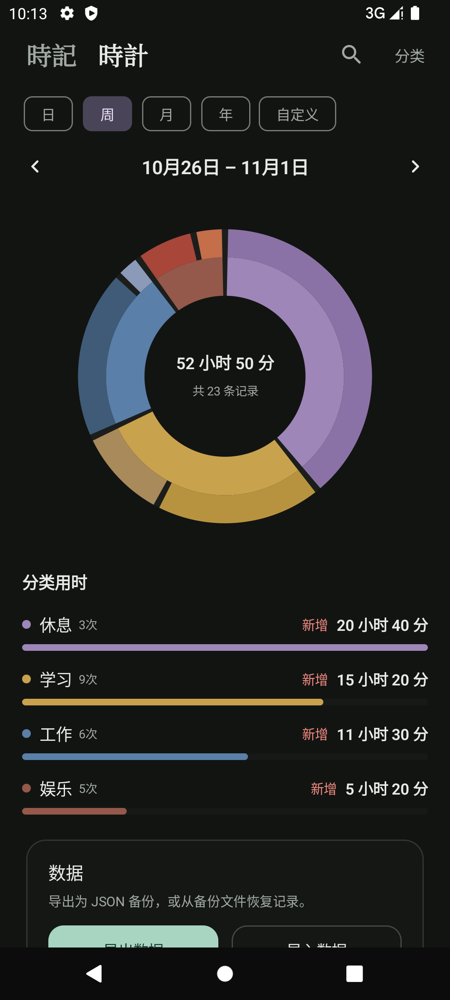
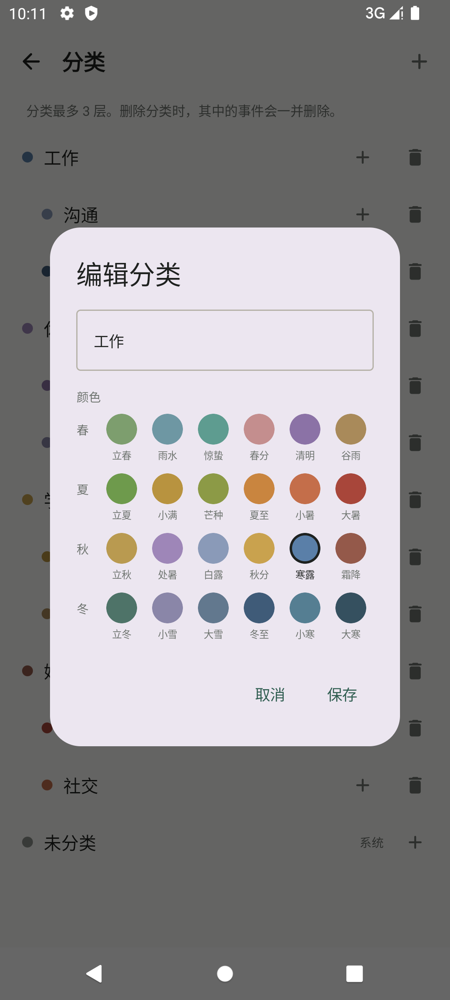

# 時 · TimeLog

一个极简的 Android 时间记录应用：把一天画成一条**时间块**的时间轴，记录做了什么、从几点到几点；另一页「時計」把时间按分类层级画成**多层环形堆叠图**，可切日 / 周 / 月 / 年并前后翻页。

项目使用 Kotlin + Jetpack Compose Material 3 + Room，严格 MVVM / 单向数据流。

> v0.1.0：应用更名「時」；主界面改叫「時記」，统计页改叫「時計」，两个页签同为 23sp 衬线样式；记录块的字号放大、整块可点，「完成」换成右下角蓝底白加号的悬浮圆钮；主界面不再显示年份，星期只留小字；分类色板改成按春夏秋冬分组的 4 行 6 列，颜色下方标注节气名；统计页重做为日 / 周 / 月 / 年 / 自定义五种查看方式，可前后翻页，总时长用三层环形堆叠图表达分类层级，「分类用时」每行带次数与环比（增红减绿），并删掉「最近 7 天」板块。






## 技术栈

| 项目 | 版本 / 取值 |
| --- | --- |
| 应用版本 | 0.1.0（versionCode 6） |
| compileSdk | 36（Android 16） |
| targetSdk | 31（Android 12） |
| minSdk | 29（Android 10） |
| Android Gradle Plugin | 9.0.1 |
| Gradle | 9.1.0 |
| SDK Build Tools | 36.0.0 |
| Kotlin | 2.2.10（AGP 9 内置 Kotlin，不额外应用 kotlin-android） |
| Compose Compiler | org.jetbrains.kotlin.plugin.compose 2.2.10 |
| Compose BOM | 2025.08.01（Compose 1.9.0 / Material3 1.3.2） |
| Room | 2.7.2（KSP 2.3.6，数据库 v4） |
| Coroutines | 1.10.2 |
| 测试 | JUnit 4.13.2（JVM 单元测试 3 个套件共 45 例） |
| UI / 架构 | Jetpack Compose + Material 3，MVVM + UDF |
| 依赖管理 | Gradle Version Catalog（`gradle/libs.versions.toml`） |
| 构建环境 | JDK 17，Android Studio 2026.1+ |

## 功能

- **时间块时间轴**：一天从 00:00 排到 24:00（今天排到「现在」），每个事件是一块有开始与结束的色块；块高随时长做温和缩放并夹在 62–220dp，长睡眠不会撑爆一屏。
- **两页左右滑动**：主界面「時記」（时间轴）与「時計」（统计）在同一层，横向滑动或点顶栏页签切换；两个页签同为 23sp 衬线，选中为墨色、未选为次要色。
- **右下角「+」**：时间轴页不再有整条「完成」按钮，改为右下角 62dp 蓝底圆圈 + 白色加号，带 8dp 阴影，避让导航栏；列表底部预留 96dp，最后一条记录不会被遮住。
- **整块可点**：点记录块的任意位置（包括块内空白）即打开块内第一条事件的编辑；块内每条记录仍可单独点按 / 长按，内层优先。
- **放大的时间与分类**：左侧时间 13sp Medium、槽宽 48dp；分类路径 14sp Medium、备注 13sp；未记录块的名称 13sp、时长 11sp。
- **日期只说必要的话**：主界面区块标题为「今天 / 昨天 / M月d日」，不再出现年份；星期只以副标题小字出现（如「11月1日 · 周日」「周五」）。
- **时间只在交界处标注**：左侧时间槽只在相邻两块的接缝处显示 `HH:mm`，块内不重复时间，视觉上像一条连续的时间带。
- **未记录自动填充**：没有事件覆盖的时间段由虚线「未分类」块补齐，超过一小时还会显示时长（如「1 小时 20 分」），保证一天永远连续、没有空洞；点这段空隙即可就地补记，弹窗会预填好起止时间。
- **正序 + 自动停在底部**：列表按时间正序，最新记录在最下方；首次进入与新增记录后自动滚到「现在」处。
- **记录不需要标题**：弹窗里只有分类、开始/结束时间、可留空的备注；默认开始时间接在上一条记录的结束时间之后（12 小时内），结束时间取当前时间。
- **分类固定网格**：记录弹窗中的分类是一个固定显示的 FlowRow 网格（根 + 子 + 孙分类胶囊），点一下即选中。
- **默认分类**：工作（沟通、执行）→ 休息（睡眠、放空）→ 学习（输入、输出）→ 娱乐（沉浸、社交）→ 系统分类「未分类」。
- **节气色板（4 × 6）**：分类编辑弹窗把 24 色按「春 / 夏 / 秋 / 冬」分成 4 行、每行 6 个色块，色块下方标注对应节气名（立春 → 大寒）；选中的色块有 2dp 描边。
- **分类管理**：最多 3 层；新建顶级/子级、编辑名称与颜色、删除。删除分类会连同其子分类与这些分类下的**全部事件**一起删除（二次确认弹窗会写明将删除多少条事件）。
- **未分类只有一种**：「未记录的空隙」与「记录到系统分类未分类的事件」读的是同一个分类实体，名称与灰色完全一致。
- **重叠可编辑**：重叠的事件仍在时间轴上合并为一块展示，但块内**每条记录都能单独点击编辑**、长按删除；整块点击则编辑块内第一条。
- **保存时编辑优先**：把正在编辑的区间写进时间轴时，其它记录让路——只在一侧重叠就裁掉那一侧；横跨两侧就保留左侧、把右侧残余拆成新记录；被整个盖住的记录会先弹「时间重叠」确认框列出，点「仍要保存」才删除。
- **备注搜索**：顶栏放大镜进入整屏搜索页，输入关键字即时过滤备注（`LIKE`），结果按时间倒序列出分类路径与日期时段，点一条直接打开编辑。
- **统计查看方式**：日 / 周 / 月 / 年 / 自定义五种；周从周一开始；每行范围导航可点击左右箭头查看前一个 / 后一个周期（未来的下个周期不可点）；自定义用两个连续日期选择器选起止日（闭区间）。
- **多层环形堆叠图**：总时长按分类层级画成最多三层的同心圆环（根 → 子 → 孙），扇区颜色取分类颜色，圆环中心显示总时长与记录条数；没有数据的周期显示浅色空轨道与「—」。
- **分类用时**：按一级分类列出用时（含全部子类）与细进度条；分类名右侧附「N次」小字；时长左侧附与上一周期的增减比例，增加红色、减少绿色、持平灰色 `0%`、上一周期为 0 则显示红色「新增」。
- **环比口径对齐**：当前周期只统计到「现在」，上一周期也只统计到「同一进度」（如今天是周日 10:13，就对比上周日 00:00–10:13），进行中的周期不会因为「还没过完」而永远显示下降。
- **导入导出**：统计页底部「数据」卡片可把分类树与全部事件导出成 `時-yyyy-MM-dd.json`；导入支持「合并导入」（同名同父分类复用，其余新建）与「覆盖导入」（清空后恢复，二次确认）。
- 长按事件删除（二次确认，对话框显示分类与时间段）。
- 跟随系统深色模式；Edge-to-edge，正确处理状态栏 / 导航栏 / IME Insets。
- 无复杂动画，所有写操作由 Room Flow 驱动界面刷新（时钟每分钟触发一次重新分块，让「现在」跟着走；统计页每 60 秒刷新一次）。

## 工程结构

```text
app/src/main/java/com/example/timelog/
├── TimeLogApplication.kt          # 手动 DI：database / repository 懒加载
├── MainActivity.kt                # edge-to-edge；「時記 / 時計」顶栏 + HorizontalPager + 右下角「+」+ 整屏浮层（搜索/分类）
├── data/
│   ├── local/
│   │   ├── AppDatabase.kt         # Room v4，MIGRATION_1_2 / 2_3 / 3_4，onCreate 写入默认分类
│   │   ├── dao/CategoryDao.kt
│   │   ├── dao/EventDao.kt        # observeAll、searchByNote、getOverlapping、deleteByCategoryIds…
│   │   └── entity/CategoryEntity.kt, EventEntity.kt
│   ├── repository/TimeLogRepository.kt   # 时间轴/搜索 Flow、重叠保存、分类删除、快照与导入
│   ├── seed/DefaultCategories.kt
│   └── transfer/TransferJson.kt   # 备份 JSON 编解码（org.json，schema 1）
├── domain/
│   ├── OverlapResolver.kt         # 纯函数：重叠时的 update / clone / victims 方案
│   ├── Statistics.kt              # 纯函数：StatsMode / StatsWindow / StatsWindows / CategoryUsage / StatsSummary / StatsBuilder
│   └── model/
│       ├── Category.kt, Event.kt
│       ├── CategoryPalette.kt     # SolarTermColor(name, season, colorHex) + SolarTerms / SolarTermSeasons
│       ├── LedgerSnapshot.kt      # 导入导出快照 + ImportMode
│       ├── Timeline.kt            # TimelineBuilder：分块、合并重叠、空隙补齐（纯函数）
│       └── CategoryTree.kt        # 树构建、路径、深度、子树、扁平化
├── ui/
│   ├── theme/Color.kt, Type.kt, Theme.kt
│   ├── home/HomeScreen.kt, HomeViewModel.kt, TimelineItem.kt
│   ├── record/RecordSheet.kt, RecordViewModel.kt, CategoryGrid.kt
│   ├── category/CategoryManageScreen.kt, CategoryManageViewModel.kt
│   ├── search/SearchScreen.kt, SearchViewModel.kt
│   ├── stats/StatisticsScreen.kt, StatisticsViewModel.kt
│   └── data/DataTransferSection.kt, DataTransferViewModel.kt
└── util/DateTimeFormat.kt
app/src/test/java/com/example/timelog/domain/
├── TimelineBuilderTest.kt         # 7 例
├── OverlapResolverTest.kt         # 12 例
└── StatisticsTest.kt              # 26 例（窗口边界、层级汇总、环比对齐、孤立分类、标签文案）
design/icons/                       # 5 个图标方案（A–E）+ overview.png + render.py
```

数据流：

```text
Room DAO(Flow) ──► TimeLogRepository.combine ──► ViewModel StateFlow<UiState>
                                                        │
Compose 事件回调 ──► ViewModel ──► Repository ──► Room ──┘（写库后 Flow 自动刷新）
```

- Composable 不访问 DAO；只接收 `UiState` 与回调。
- 时间分块（`TimelineBuilder`）、重叠求解（`resolveOverlap`）、统计（`StatsBuilder`）都是纯函数，可离线单元测试；ViewModel 只做映射与调度。
- 所有业务状态放在 `data class ...UiState` 中，Composable 里不散落业务 `remember`。

## 关键设计取舍

- **事件是「块」而不是「点」**。`EventEntity` 只有 `startAt / endAt / note`，没有标题：只有起止时间才能画出连续的一天，也只有连续的一天才有「未记录的空隙」可言。
- **数据库迁移**：
  - `MIGRATION_1_2`：旧事件按 30 分钟补全为区间，旧标题并入备注（两者都有则 `title / note`）。
  - `MIGRATION_2_3`：只调整默认种子的 4 个 `sortOrder`。
  - `MIGRATION_3_4`：把仍是**旧默认色**的 12 个种子分类换成 24 色板里的新色；用户改过的颜色用 `WHERE colorHex = 旧值` 保护，不会被覆盖。
- **未记录段只在展示层生成**，不写数据库；它由「一天从 00:00 到 24:00（今天到 now）」减去事件区间得到。空隙里的「未分类」与系统分类「未分类」共用同一份 `Category`（id 5）。
- **重叠合并成一块，但块内逐条可点**：点击目标既下沉到块内每一行（分类 + 备注），也覆盖整块空白区域——点块内任意位置编辑第一条，点具体某一行编辑那一条。
- **保存时「正在编辑的这条」优先**（`OverlapResolver`）。区间按半开 `[start, end)`：首尾相接不算重叠。其它记录：
  - 只在一侧超出 → 原地裁剪到不重叠的那一段（`OverlapUpdate`，静默生效）；
  - 横跨目标区间两侧 → 保留左侧，右侧残余复制成一条新记录（`OverlapClone`，保留原备注/分类/创建时间）；
  - 被目标区间整个盖住 → 进入 `victims`，先弹「时间重叠」确认框列出时间与备注，用户点「仍要保存」才删。
- **删除分类 = 连事件一起删**（用户明确要求）。事件外键是 `RESTRICT`，所以事务里先 `deleteByCategoryIds(subtreeIds)` 再删分类，子分类由自引用外键 `CASCADE` 清理；确认弹窗实时显示「其中 N 条事件会一并删除」。
- **节气色板带名字**。`SolarTermColor(name, season, colorHex)` 把 24 色按四季分组；编辑弹窗用 4 行 × 6 列网格，每格 28dp 圆点 + 9sp 节气名。颜色仍只用于圆点与色块，正文不出现节气文字。
- **浮动「+」而不是整条按钮**。记录是高频动作，右下角圆形 FAB 更贴近拇指热区，也让时间轴多出 56dp 的可视高度；空态文案同步改成「点右下角的 +」。
- **统计是纯函数**。`StatsBuilder.build(events, tree, window, now, zone)` 只依赖入参：先把事件裁剪到窗口与 `now` 的交集，再沿 `CategoryTree` 向上汇总时长与次数（根含全部子类），最后按用时降序输出树。窗口、翻页、环比全部由 `StatsWindows` 计算，不读系统时钟。
- **环图只画三层**。环形图用 Canvas `drawArc + Stroke` 画同心圆环：根分类（内环）→ 二级 → 三级；深处超过三层的分类时长已计入祖先，不再单独展开。每层有内容时才画 0.3 alpha 的轨道，空周期显示「—」。
- **环比对齐已过时长**。当前周期「今天 / 本周 / 本月 / 今年」还没过完，若直接对比完整上一周期会永远显示下降；因此上一周期只统计到 `previousStart + (now - currentStart)`。上一周期为 0 时 `deltaRatio` 为 `null`，界面显示「新增」。
- **自定义时间段可翻页**。自定义窗口按窗口长度（毫秒）平移，仍复用同一套前后箭头；`goNext` 有「目标窗口开始时间不能晚于现在」的守卫，不会翻到纯未来的空白页。
- **导入导出不新增依赖**。备份用 Android 自带 `org.json` 编解码，schema 固定为 1；`MERGE` 按「同名 + 同父」复用分类、事件通过旧 ID→新 ID 映射写入，`REPLACE` 先清空事件与分类再按父先子后的顺序重建。文件读写在 SAF 里用 `CreateDocument / OpenDocument` 完成，不申请存储权限。
- **块高做压缩而非严格等比**：24 小时严格等比会得到 1440dp 的列表，一屏看不到一小时。用 `58 + 分钟 × 0.60 + 额外行 × 28` 并夹到 62–220dp，保留「长块长、短块短」的节奏感。
- **记录弹窗去掉标题**。高频录入场景里标题是负担；分类已经表达了「这是什么」，备注保留自由描述。
- **弹窗形态：ModalBottomSheet**。记录是高频、单手操作，底部弹出更贴近拇指热区；分类、删除、导入方式仍用 AlertDialog。
- **手动依赖注入**。项目有 6 个 ViewModel 和 1 个 Repository，通过 `TimeLogApplication` 懒加载单例 + `viewModelFactory` 注入即可；引入 Hilt 会增加 KSP 处理与样板代码，不符合极简目标。
- **时间处理**：业务时间统一存 epoch millis，展示与转换使用系统默认时区；Material3 DatePicker 的毫秒按 UTC 日界线处理，`DateTimeFormat.startOfDayUtcMillis / dateFromUtcMillis` 专门做这层转换。
- **图标选定 A 墨時并已落到资源**。5 个方向在 `design/icons/` 下（Pillow 可复现渲染，4× 超采样 + LANCZOS，遵守自适应图标安全区）；`build_launcher_assets.py` 从 `icon-A.png` 抽出纸白「時」生成 108dp 透明前景，背景沿用 `ic_launcher_background` 的松绿 `#2F5D50`。

## 图标方案

五个方向的对照图：[design/icons/overview.png](design/icons/overview.png)

| # | 名称 | 概念 |
| --- | --- | --- |
| A | 墨時 | 松绿底 + 纸白「時」字，字即图标 |
| B | 素時計 | 极简表盘：墨色圆圈 + 时针分针 + 一点陶土色秒针 |
| C | 時流 | 三块不同高度的圆角时间块，把「一天的节奏」画出来 |
| D | 朱印 | 陶土色印章，纸白「時」+ 内框，像给一天盖戳 |
| E | 日月弧 | 从墨色月点到陶土色日点的一条细弧，一天即一弧 |

**已采用 A（墨時）**：前景 = 纸白「時」，背景 = 松绿，已生成到 `app/src/main/res/drawable-*dpi/ic_launcher_foreground.png`。
其余四个方案与 `overview.png` 保留作设计记录，重新生成前景执行：

```bash
python design/icons/build_launcher_assets.py
```

调色板：纸 `#FBFAF7`、墨 `#1E211F`、松 `#2F5D50`、松浅 `#E6EFEA`、陶土 `#B4654A`、赭 `#C07A2B`、hairline `#E4E1DA`；动作蓝 `#2F6FE4`（右下角「+」）。

## 构建与运行

前置：JDK 17、Android SDK Platform 36、Build Tools 36.0.0，Android Studio 2026.1+。

1. 打开项目根目录，确认 `local.properties` 指向本机 SDK：

   ```properties
   sdk.dir=D\:\\Android\\Sdk
   ```

   `local.properties` 已在 `.gitignore` 中排除，不要提交。

2. 命令行构建与测试：

   ```bash
   ./gradlew testDebugUnitTest assembleDebug
   ```

   Windows PowerShell / CMD 可用 `gradlew.bat`。产物：

   ```text
   app/build/outputs/apk/debug/app-debug.apk
   dist/時-0.1.0.apk        # 另存的演示安装包
   ```

3. 启动模拟器（任意 API 29–36 镜像，项目在 API 31 的 Pixel 6 上验证）并安装：

   ```bash
   adb install -r app/build/outputs/apk/debug/app-debug.apk
   adb shell am start -n com.example.timelog/.MainActivity
   ```

4. 也可以在 Android Studio 中直接 Run 'app'；AGP 9 要求同步使用 JDK 17。

重新生成图标稿（可选，需要 Pillow + 中文字体）：

```bash
python design/icons/render.py
```

## 手动验收清单

以下均在 API 31 Pixel 6 模拟器（1080×2400）上实际点按验证：

- [x] 应用名叫「時」，桌面图标与顶栏一致；顶栏两个页签「時記」「時計」同款 23sp 衬线，选中为墨色、未选为次要色。
- [x] 时间轴页没有整条「完成」按钮，右下角是 62dp 蓝底圆圈 + 白色加号；点击打开「记录一段」。
- [x] 主界面时间 13sp、分类路径 14sp；日期标题为「今天 / 昨天 / M月d日」，不显示年份，星期只在副标题小字里（如「11月1日 · 周日」）。
- [x] 点记录块内空白区域也能打开编辑（实测打开 09:00–12:00「做需求评审」）；块内每条记录仍可单独点按。
- [x] 分类编辑弹窗为 4 行 × 6 列节气色板：春 / 夏 / 秋 / 冬 四行，每色下方标注节气名，选中色块有描边。
- [x] 统计页顶栏为 日 / 周 / 月 / 年 / 自定义 五个 chip；左右箭头可查看前一个 / 后一个周期（当前为「今天」时右箭头禁用）。
- [x] 周视图（10月26日 – 11月1日）三层环图：外、中、内三圈分别对应根 / 子 / 孙分类，中心显示 52 小时 50 分、23 条记录。
- [x] 上周边（10月19日 – 10月25日）为空：浅色空轨道 + 「—」+「这段时间还没有记录」。
- [x] 月视图「2026年10月」、年视图「2026年」、自定义视图「10月26日 – 11月1日」均显示对应数据；点「修改」弹出起始日 DatePicker。
- [x] 分类用时行：分类名右侧「N次」，时长左侧环比——增加红色（+8%）、减少绿色（-58%）、持平「0%」灰色、上一周期无记录显示红色「新增」。
- [x] 统计页不再有「最近 7 天」柱状图；总时长卡片与「分类用时」之间只保留环形图。
- [x] 导出文件名改为 `時-2026-11-01.json`（schema 1）。
- [x] 深色模式下环图、环比红绿（RiseRedDark / FallGreenDark）、色板、FAB 均正确。
- [x] 分类页提示语为「分类最多 3 层。删除分类时，其中的事件会一并删除。」
- [x] 旧版本数据库（v3）升级到 v4：默认分类换新色、用户自定义色保留、记录完整（沿用 v2.2 迁移）。
- [x] `am force-stop` 后重启，数据完整保留。
- [x] `./gradlew testDebugUnitTest assembleDebug --console=plain --offline` 全绿（TimelineBuilder 7 + OverlapResolver 12 + Statistics 26 = 45 例）。

## 已知限制

- 分类最多 3 层；不支持拖拽排序，同级按创建顺序（`sortOrder`）排列。
- 环形图最多展开 3 层，更深分类的时长只计入祖先，不再单独成环。
- 极小占比的扇区受最小 1° 角度影响，视觉上可能轻微重叠（不影响数据）。
- 自定义时间段允许选未来日期：窗口在将来时显示「这段时间还没有记录」，右箭头不会翻到未来空白页。
- 事件删除与分类删除都是硬删除，无回收站 / 撤销。
- 分类名称未做同级重名校验。
- 「未分类」填充段是展示层推导的，本身不是数据库记录；可点按补记，但不能直接长按删除。
- 搜索只查备注，不含分类名与日期条件。
- 统计把重叠事件各算各的，因此总时长可能大于所选范围的墙钟时长（与分类明细口径一致）。
- 合并导入按原样追加事件：同一份备份导入两次会得到两份事件（不做去重）；如需干净恢复请用覆盖导入。
- 升级用户不会自动获得新分类体系（保留原分类树），需要时在分类管理里手动加。
- 未做平板 / 横屏专属布局，界面按手机竖屏设计。
