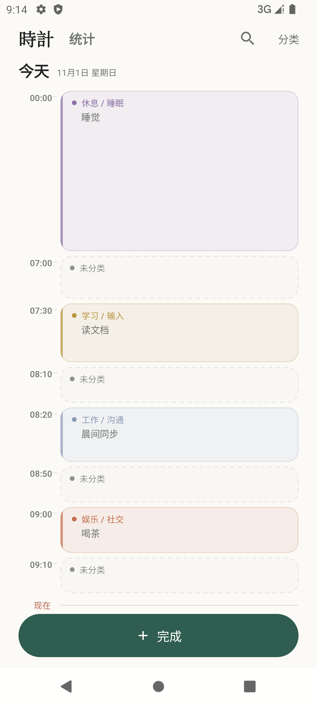
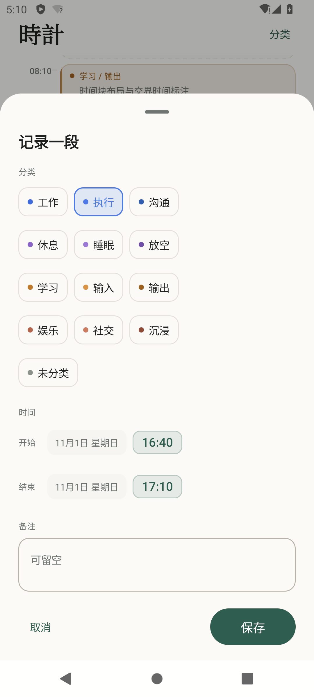
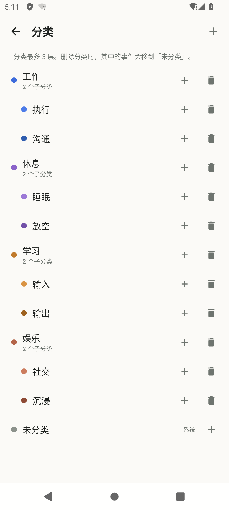
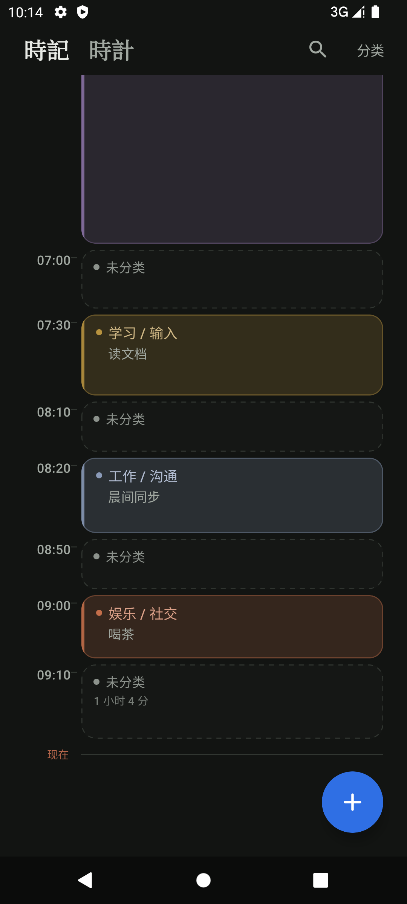

# 时间流 · TimeLog

一个极简的 Android 时间记录应用：把发生的事按时间排成一条纵向时间流。项目从零搭建，使用 Kotlin + Jetpack Compose Material 3 + Room，严格 MVVM / 单向数据流。






## 技术栈

| 项目 | 版本 / 取值 |
| --- | --- |
| compileSdk | 36（Android 16） |
| targetSdk | 31（Android 12） |
| minSdk | 29（Android 10） |
| Android Gradle Plugin | 9.0.1 |
| Gradle | 9.1.0 |
| SDK Build Tools | 36.0.0 |
| Kotlin | 2.2.10（AGP 9 内置 Kotlin，不额外应用 kotlin-android） |
| Compose Compiler | org.jetbrains.kotlin.plugin.compose 2.2.10 |
| Compose BOM | 2025.08.01（Compose 1.9.0 / Material3 1.3.2） |
| Room | 2.7.2（KSP 2.3.6） |
| Coroutines | 1.10.2 |
| UI / 架构 | Jetpack Compose + Material 3，MVVM + UDF |
| 依赖管理 | Gradle Version Catalog（`gradle/libs.versions.toml`） |
| 构建环境 | JDK 17，Android Studio 2026.1+ |

## 功能

- 纵向时间轴：左侧细竖线 + HH:mm 时间胶囊，右侧标题、分类路径、最多两行备注。
- 按天分组（今天 / 昨天 / M月d日），事件按时间倒序，最新在上。
- 底部固定胶囊「完成」按钮，打开 ModalBottomSheet 记录事件：分类、标题、备注、日期、时间。
- 分类最多 3 层（顶级 / 子级 / 孙级）；首次建库预置工作、生活、学习、休息及子分类，并预置系统分类「未分类」。
- 分类管理：新建顶级/子级、编辑名称与颜色、删除；删除父分类会级联删除子分类，并把其中的事件迁移到「未分类」。
- 点击事件编辑，长按事件删除（二次确认）。
- 跟随系统深色模式；Edge-to-edge，正确处理状态栏 / 导航栏 / IME Insets。
- 无复杂动画，所有写操作由 Room Flow 驱动界面刷新。

## 工程结构

```text
app/src/main/java/com/example/timelog/
├── TimeLogApplication.kt          # 手动 DI：database / repository 懒加载
├── MainActivity.kt                # edge-to-edge、三个 ViewModel、页面与弹窗调度
├── data/
│   ├── local/
│   │   ├── AppDatabase.kt         # Room v1，onCreate 写入默认分类
│   │   ├── dao/CategoryDao.kt
│   │   ├── dao/EventDao.kt
│   │   └── entity/CategoryEntity.kt, EventEntity.kt
│   ├── repository/TimeLogRepository.kt
│   └── seed/DefaultCategories.kt
├── domain/model/
│   ├── Category.kt
│   ├── Event.kt                   # Event + TimelineEvent（已组装分类路径与颜色）
│   └── CategoryTree.kt            # 树构建、路径、深度、子树、扁平化
├── ui/
│   ├── theme/Color.kt, Type.kt, Theme.kt
│   ├── home/HomeScreen.kt, HomeViewModel.kt, TimelineItem.kt
│   ├── record/RecordSheet.kt, RecordViewModel.kt
│   └── category/CategoryPicker.kt, CategoryManageScreen.kt, CategoryManageViewModel.kt
└── util/DateTimeFormat.kt
```

数据流：

```text
Room DAO(Flow) ──► TimeLogRepository.combine ──► ViewModel StateFlow<UiState>
                                                        │
Compose 事件回调 ──► ViewModel ──► Repository ──► Room ──┘（写库后 Flow 自动刷新）
```

- Composable 不访问 DAO；只接收 `UiState` 与回调。
- 分类树在 Repository / domain 层构建，UI 只消费 `CategoryTree`。
- 时间分组、排序在 `HomeViewModel` 中用 Flow 转换；事件本身由 SQL `ORDER BY timestamp DESC, id DESC` 排序。
- 所有业务状态放在 `data class ...UiState` 中，Composable 里不散落业务 `remember`。

## 关键设计取舍

- **弹窗形态：ModalBottomSheet**。记录是高频、单手操作，底部弹出更贴近拇指热区，也能容纳分类树 + 两个输入框 + 时间选择；Dialog 高度受限。分类编辑和删除确认仍用 AlertDialog。
- **手动依赖注入**。项目只有 3 个 ViewModel 和 1 个 Repository，通过 `TimeLogApplication` 懒加载单例 + `viewModelFactory` 注入即可；引入 Hilt 会增加 KSP 处理与样板代码，不符合极简目标。
- **分类层级限制为 3 层**。UI 在深度 2（0 基）隐藏「添加子分类」，ViewModel 再做一次深度校验；树结构本身可继续扩展，但交互刻意限制，避免缩进过深。
- **删除分类的策略**：先统计整棵子树的事件数，事务内把这些事件改派到系统分类「未分类」，再删除根分类；子分类由 `category.parentId` 自引用外键 `ON DELETE CASCADE` 清理。事件外键是 `RESTRICT`，所以必须先迁移事件。这样整理分类不会丢记录。
- **「未分类」是系统分类**：固定 ID 5、`isSystem = true`，不可删除、不可被当作普通分类误删；提供兜底。
- **时间处理**：业务时间统一存 epoch millis，展示与转换使用系统默认时区；Material3 DatePicker 的毫秒按 UTC 日界线处理，`DateTimeFormat.startOfDayUtcMillis / dateFromUtcMillis` 专门做这层转换，避免时区偏移一天。
- **targetSdk 31 与 compileSdk 36 的差距**：项目没有使用 API 32+ 才有的接口；Compose / Activity / Room 均在 minSdk 29 可用。未添加 `Build.VERSION.SDK_INT` 分支，因为不存在需要运行时保护的新 API。
- **数据库 v1 不导出 schema**：当前只有首版结构，未配置迁移；后续加字段时应改为 `exportSchema = true` 并提供 Migration 或 destructive 策略。
- **无自动化测试**：本次交付以 `assembleDebug` 编译零警告 + API 31 模拟器真机流程验证为准；没有编写 JVM/Robolectric/Compose UI 测试，避免为极简 UI 引入额外测试依赖。

## 构建与运行

前置：JDK 17、Android SDK Platform 36、Build Tools 36.0.0，Android Studio 2026.1+。

1. 打开项目根目录，确认 `local.properties` 指向本机 SDK：

   ```properties
   sdk.dir=D\:\\Android\\Sdk
   ```

   `local.properties` 已在 `.gitignore` 中排除，不要提交。

2. 命令行构建：

   ```bash
   ./gradlew assembleDebug
   ```

   Windows PowerShell / CMD 可用 `gradlew.bat assembleDebug`。产物：

   ```text
   app/build/outputs/apk/debug/app-debug.apk
   ```

3. 启动模拟器（任意 API 29–36 镜像，项目在 API 31 的 Pixel 6 上验证）并安装：

   ```bash
   adb install -r app/build/outputs/apk/debug/app-debug.apk
   adb shell am start -n com.example.timelog/.MainActivity
   ```

4. 也可以在 Android Studio 中直接 Run 'app'；AGP 9 要求同步使用 JDK 17。

## 手动验收清单

- [x] 空库冷启动显示居中浅灰空状态，无多余按钮。
- [x] 点击「完成」→ BottomSheet 出现；展开「工作」选择「项目A」，输入标题与备注，保存。
- [x] 列表顶部出现事件，左侧 06:54 时间胶囊与竖线对齐，分类显示「工作 / 项目A」。
- [x] 再记录一条，两条事件由各自时间戳分隔，按时间倒序。
- [x] 点击事件编辑分类与时间，列表按新时间重新排序。
- [x] 长按事件 → 二次确认 → 删除后列表与计数更新。
- [x] 分类管理新建二级/三级分类；三级分类不再显示新增子级入口。
- [x] 删除带事件和子分类的「阅读」：提示 1 条事件迁移、子分类级联删除；首页事件变为「未分类」。
- [x] 系统深色模式切换后背景、文字、按钮、时间轴配色正确。
- [x] `am force-stop` 后重启，Room 数据完整保留。
- [x] `./gradlew :app:assembleDebug --warning-mode all` 成功，无 Kotlin 编译警告。

## Git 提交规划

首次提交固定为：

```text
chore: init project skeleton
```

之后按功能拆分：

```text
feat(data): add Room schema, DAOs and repository
feat(home): build timeline screen with day grouping
feat(record): add bottom-sheet event editor
feat(category): add tree management and safe deletion
feat(app): wire screens, navigation and edge-to-edge
docs: add project guide and screenshots
docs: add complete source bundle
```

## 已知限制

- 分类最多 3 层；不支持拖拽排序，同级按创建顺序（`sortOrder`）排列。
- 事件删除是硬删除，无回收站 / 撤销。
- 分类名称未做同级重名校验。
- 无搜索、筛选、统计、导出、提醒、重复事件。
- 数据库 v1 无迁移；后续升级 schema 需补 Migration。
- 未做平板 / 横屏专属布局，界面按手机竖屏设计。
