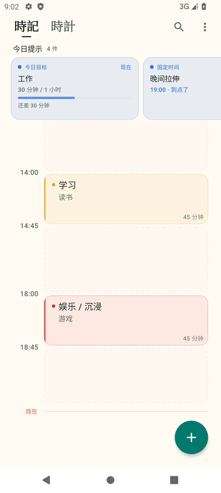
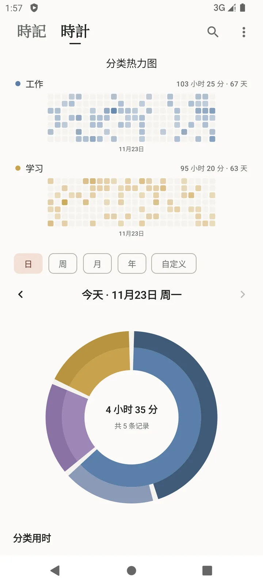
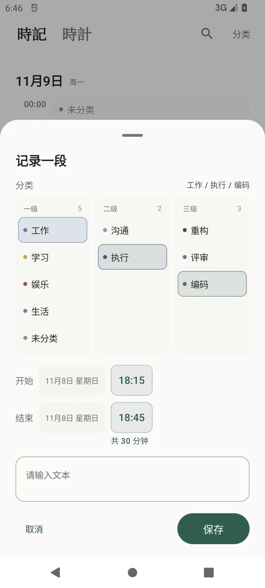
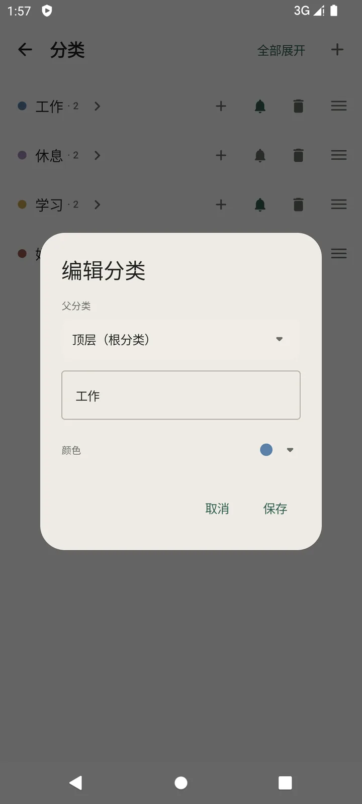
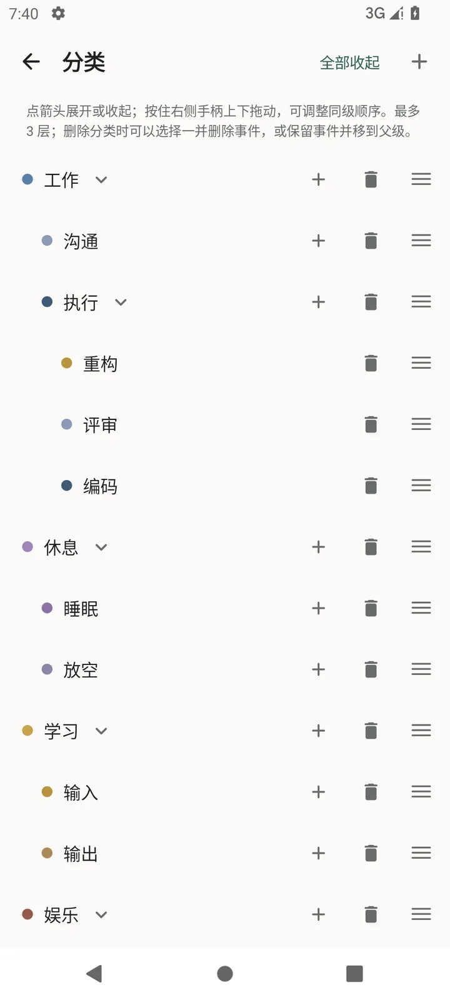
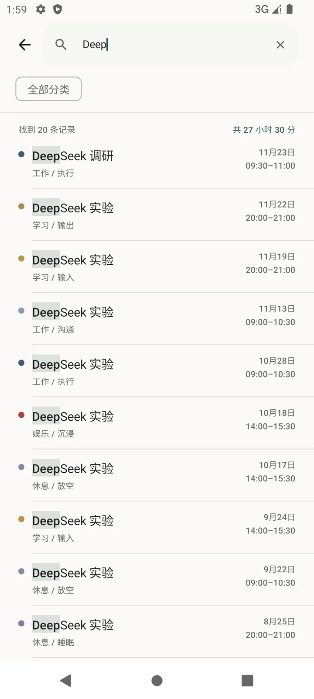

# 時 · Shi

> 纯本地、无账号、无联网权限的 Android 时间记录器：用时间块和多层环图记录、复盘一天。

[](https://github.com/7huig/Shi/releases/tag/v0.4.1)
[](https://github.com/7huig/Shi/actions/workflows/android.yml)
[](LICENSE)
[](https://developer.android.com/about/versions/android-10)

**[下载 Shi 0.4.1 APK](https://github.com/7huig/Shi/releases/download/v0.4.1/Shi-0.4.1.apk)** · Android 10+ · 约 3.2 MB · 无广告

[全部版本与校验值](https://github.com/7huig/Shi/releases) · [English Quick Start](#english-quick-start) · [验收与 FAQ](docs/QA.md) · [目标与提醒设计](docs/plan-reminders.md)

> 数据只保存在本机。**卸载或清除应用数据会删除记录，请先导出 JSON 备份。**

## 记录一天，也看清一天

| 时间块时间轴 | 可交互的多层环图 |
|:---:|:---:|
|  |  |

- **时间块时间轴**：连续展示记录与安静空白，点空白即可记录；不写「未记录 / 补记」，记录不全不会被反复提醒；重叠记录仍可分别编辑。
- **统计与下钻**：日／周／月／年／自定义窗口，环图选中、分类联动、层级下钻与环比；不再显示覆盖率百分比。
- **目标与提醒**：在「分类管理」里为每个分类设每日时长、多个固定时间（可设提前提示）与间隔待办；首页只做静态提示，不发系统通知；固定时间和间隔待办都会读取记录自动刷新。热力图按分类开启，置顶在時計页并展示最近 24 周。
- **轻量记录**：三级分类三栏依次选择、分类展开收起、拖动排序、节气色板、备注搜索与命中总时长；长按「+」可按最近分类和 15/30/45/60 分钟快速记录。
- **分类调整**：子分类可升为顶层，父分类可移到其他分类下（含子树整体移动，仍限 3 层）；搜索页支持只按分类筛选，所选分类包含整棵子树。
- **本地备份**：导出 JSON；合并导入识别重复事件，也可覆盖恢复。没有账号、云端同步或网络权限。

## 安装与数据

1. 下载上方 APK，按 Android 提示允许本次侧载安装。
2. 覆盖升级必须使用同一签名；升级前建议先导出 JSON。不要混用不同签名的安装包。
3. 应用不申请网络或存储权限，系统云备份与设备迁移也已排除；换机请手动导出备份。
4. 已知边界与验收记录见 [QA / FAQ](docs/QA.md)。

<details>
<summary>更多截图</summary>

| 记录表单 | 分类编辑 | 分类管理 | 备注搜索 |
|:---:|:---:|:---:|:---:|
|  |  |  |  |

深色模式：[时间轴](docs/screenshots/home-dark.webp) · [统计](docs/screenshots/stats-dark.webp)

目标与提醒：[最近 24 周热力图](docs/screenshots/category-heatmap.webp)

</details>

## Roadmap

**Now**：本地数据可靠性、手机端记录与统计体验、Android 10+ 侧载使用。

**Next**（候选方向，不承诺时间）：targetSdk 36、UI 自动化测试与截图回归、平板／横屏布局、英文界面。欢迎通过 [Issue](https://github.com/7huig/Shi/issues) 讨论优先级。

**Not planned**：账号体系、云端同步、广告与订阅。

## 技术栈与质量

| 项目 | 版本 / 取值 |
| --- | --- |
| 应用版本 | 0.4.1（versionCode 14） |
| Android | minSdk 29 · targetSdk 31 · compileSdk 36 |
| 语言与工具 | Kotlin 2.2.10 · Gradle 9.1.0 · AGP 9.0.1 · JDK 17 |
| UI | Jetpack Compose（BOM 2025.08.01）· Material 3 |
| 数据 | Room 2.7.2（数据库 v11）· Coroutines 1.10.2 |
| 架构 | MVVM + 单向数据流，纯函数 domain 层 |
| 验证 | 203 个 JVM 单元测试（含 Room 迁移、分类计划、24 周热力图、搜索筛选与 JSON 备份编解码）· CI test / lint / assembleDebug / assembleRelease · Pixel 6 API 31 手动验收 |

## 从源码构建

前置：JDK 17、Android SDK Platform 36、Build Tools 36.0.0。

```bash
git clone https://github.com/7huig/Shi.git
cd Shi

./gradlew testDebugUnitTest lintDebug assembleDebug
adb install -r app/build/outputs/apk/debug/app-debug.apk
adb shell am start -n io.github.huig7.shi/.MainActivity
```

Windows 使用 `gradlew.bat`。Release 开启 R8 与资源收缩；如需签名，在仓库根目录配置**不提交到 Git** 的 `keystore.properties`：

```properties
storeFile=release-keystore.jks
storePassword=…
keyAlias=shi
keyPassword=…
```

没有该文件也能构建未签名 Release。贡献代码请阅读 [CONTRIBUTING](CONTRIBUTING.md)；首次克隆后执行一次 `sh githooks/install.sh` 以启用 20 KiB 代码文件上限的提交前检查。

## 工程结构

```text
app/src/main/java/io/github/huig7/shi/
├── MainActivity.kt                # 「時記 / 時計」+ Pager + 整屏浮层
├── TimeLogApplication.kt          # 手动 DI
├── data/                          # Room、Repository、种子分类、JSON 备份
├── domain/                        # 时间轴、重叠、统计、分类树等纯函数
├── ui/                            # home / record / stats / category / search / plan / data
└── util/DateTimeFormat.kt
app/src/test/java/io/github/huig7/shi/          # JVM 单元测试（domain / 备份 / 迁移 / 分类与搜索）
app/schemas/                                    # Room 导出的 schema JSON，迁移测试据此校验
design/icons/                       # 墨時图标与可复现渲染脚本
githooks/                           # pre-commit：拦截超过 20 KiB 的代码文件
```

## 已知限制

- 分类与环图最多 3 层；移动分类时会校验整棵子树，避免超层。
- 单条记录删除后可用 Snackbar 撤销；没有回收站，分类删除本身不可撤销（可以选择保留事件并移到父级或其他分类）。
- 搜索匹配备注，分类筛选按分类树生效；仍不支持日期条件。重叠事件分别累计，总时长可能大于墙钟时长。
- 未做平板／横屏专属布局；targetSdk 仍为 31，上架 Google Play 前需升级并重新验证。
- 每个分类最多一条每日时长、8 个固定时间与一条间隔待办；固定时间可设提前提示，间隔待办的记录跨天也能自动刷新；提醒只在应用内静态展示，不申请通知权限。

## English Quick Start

**Shi (時)** is a local-only Android time logger with a continuous block timeline and interactive multi-ring statistics. No account, ads, network permission, or cloud sync.

**[Download Shi 0.4.1 APK](https://github.com/7huig/Shi/releases/download/v0.4.1/Shi-0.4.1.apk)** · Android 10+ · about 3.2 MB · [Release notes & checksum](https://github.com/7huig/Shi/releases/tag/v0.4.1)

- Record and edit time blocks, tap quiet blanks to record, and search notes with total duration; incomplete days are never labelled or nagged.
- Explore day / week / month / year / custom windows, select ring segments, and drill into categories.
- Set per-category daily duration, multiple fixed times (with optional lead-time prompts), and interval todos inside category management; static in-app prompts only, and both fixed times and interval todos refresh from recorded events, across midnight. Opt-in 24-week category heatmaps sit at the top of the stats page.
- Export JSON before uninstalling or switching devices; local data is erased with app data.

Known limits: three category levels, no cloud sync, phone-first layout, targetSdk 31. Single-record delete can be undone from the snackbar. See [QA / FAQ](docs/QA.md) and [source build instructions](#从源码构建).

## License

[Apache License 2.0](LICENSE) © 2026 [7huig](https://github.com/7huig)

感谢 **DeepSeek-V4.1-Flash** 与 **DeepSeek Harness** 在开发过程中提供的帮助。「墨時」图标使用 Noto Serif SC（SIL OFL 1.1）渲染，字体不随仓库分发。
